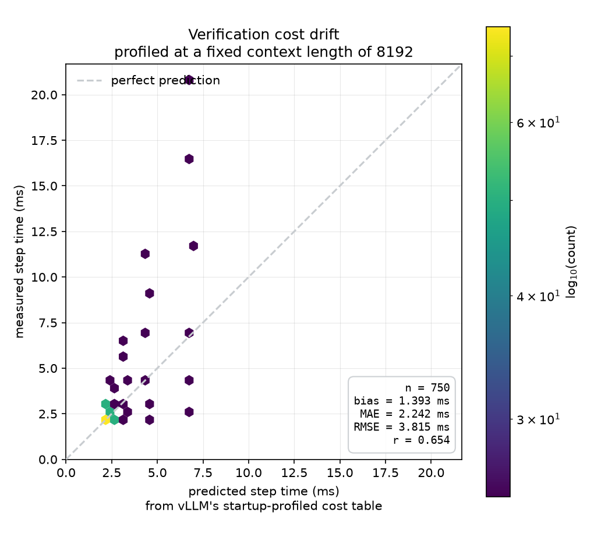
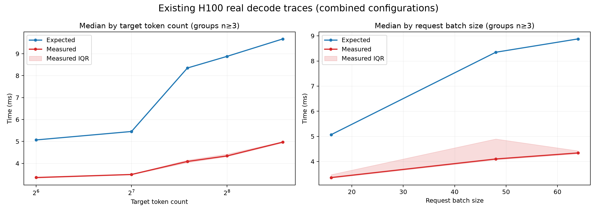

# Profiling vLLM DSpark's Verification Cost Model

I was looking into how vLLM's DSpark speculative decoding decides how many draft tokens to verify, and I noticed something interesting about its cost model: **it mainly uses the number of target tokens, not how much KV cache context those tokens need to attend to.**

That seemed like a potentially important omission. Two decode batches could be verifying the same number of tokens, but one might have 512 tokens of context per request while the other has 8,192. I wanted to see how much that changes the actual GPU time, whether I could model the difference, and whether a better estimate would make DSpark faster.

I ran the experiments on an NVIDIA H100 using vLLM's V2 runner, CUDA graphs, and Qwen3-1.7B / MiniCPM5-2B.

## The problem

DSpark's adaptive verifier uses a startup profile to estimate the cost of a target-model verification step. Simplifying slightly, the estimate looks like:

```text
estimated_cost = f(num_target_tokens)
```

Here, `num_target_tokens` includes both normal decode positions and the draft tokens selected for verification. The problem is that the profile is measured at a particular context length, so the same entry gets reused for batches with very different sequence lengths.

My hypothesis was that the total context across active requests should also matter. In the CUDA-graph regime I tested, an additive model worked well:

```text
verification_time ≈ f(num_target_tokens) + k * sum(sequence_lengths)
```

Since vLLM's original profile already includes some KV-cache work, I used the *difference* from the profiled context rather than adding the entire term again:

```text
corrected_cost[t] = stock_cost[t]
                  + k * (real_sum_seq_lens - profiled_sum_seq_lens[t])
```

`k` is the extra cost per KV token for that model and GPU configuration. It needs to be measured; it isn't a universal constant.

## What I found

| Experiment | Result |
| --- | --- |
| Predicting verification time on held-out contexts | RMSE dropped from **5.779 ms to 0.496 ms** (11.6x lower) |
| Context shorter than vLLM's profile | The stock estimate generally **overpredicts** |
| Context longer than vLLM's profile | The stock estimate **underpredicts**, by up to 202% in the tested Qwen/H100 sweep |
| Fitted `k` on H100, Qwen3-1.7B | **0.0356 µs/KV-token** |
| Fitted `k` on H100, MiniCPM5-2B | **0.0137 µs/KV-token** |
| Calibrated serving A/B, MiniCPM5-2B, 64 requests, `spec=7` | The corrected model was **0.365% slower**, not faster |

The first result was what I expected: sequence length does affect verification cost, and one extra feature explains a lot of the prediction error. The last result was more interesting.

### The error actually changes direction

With shorter contexts, the original profile assumes more KV-cache work than is actually needed. With longer contexts, it assumes less. The prediction error crosses zero near the context used during profiling.



I also compared the estimates with real decode steps, grouped by target-token count and request count. In the short-context traces, the stock estimates were generally too high even as the error increased with batch size.



This relates to [vLLM issue #52057](https://github.com/vllm-project/vllm/issues/52057), which looks at verification-cost estimation under different workloads.

## So did the correction improve throughput?

**No, at least not for the serving workload I tested.**

For the calibrated MiniCPM5-2B experiment, I used 64 concurrent requests, seven draft tokens per request (`spec=7`), and 128 output tokens per request. At full draft budget, a step could contain:

```text
64 decode tokens + 64 * 7 draft tokens = 512 target tokens
```

The stock cost estimate for a typical step was about **8.622 ms**, versus **6.030 ms** with the correction. This changed DSpark's decisions: it was less likely to keep the maximum number of draft tokens when verification appeared cheaper.

That sounds reasonable, except removing draft tokens can mean that some requests need another target-model pass later. Across 20 paired runs with matching output-token counts:

| Metric | Stock model | Corrected model |
| --- | ---: | ---: |
| Decode decisions | 347 | 360 |
| Median throughput | 10,971.9 tokens/s | 10,923.5 tokens/s |

The corrected model ended up doing **13 additional decode batches** and had **0.3649% lower throughput** on average across paired runs.

That was the main thing I learned from this experiment: **predicting the cost of a step more accurately is not the same as making a better scheduling decision.** The verifier also needs to account for what trimming drafts does to future decode iterations.

I tried a simpler comparison too: what if we ignored the adaptive cost model and admitted every available draft token? In the tested setup, stock DSpark was **1.1% slower at 64 requests** and **2.8% slower at 128 requests** than that baseline. It was slightly better at 16 requests and roughly tied at 256. At high concurrency, a separate logits-budget cap also starts limiting the draft budget, so the cost model is no longer the only thing determining the choice.

## How I benchmarked it

A big part of this project was making sure I was actually measuring GPU execution time and not compilation, warmup, or differences in the test setup.

- Profiled target passes at different target-token counts, request counts, and context lengths.
- Warmed up **all** execution shapes before timing to avoid counting JIT compilation and autotuning as runtime.
- Interleaved and reversed measurement order to reduce clock and thermal drift.
- Kept CUDA-graph and eager results separate.
- Calibrated `k` inside the same live DSpark engine used for the serving A/B test.
- Alternated stock and corrected runs, checked that they generated the same number of tokens, and excluded clamped cost measurements.

One early benchmark appeared to show a **28% difference** from an allocation change. After fixing the warmup and measurement order, that difference fell to **0.21%**. That was a good reminder of how easy it is to benchmark the wrong thing on a GPU.

## Running the experiments

The main serving experiments use an H100 with vLLM 0.28 and its V2 model runner. The Slurm files under `pace/` are configured for my cluster, so you will need to update the environment paths and cached model locations if you run them elsewhere.

```bash
git clone https://github.com/adixg/vllm-specdecode-cost-model.git
cd vllm-specdecode-cost-model
sbatch pace/run_serving_context_sweep.sbatch
```

The context sweep is set up to compare stock and corrected scheduling using:

```text
Input lengths:        64, 512, 1024, 2048, 3000 tokens
Concurrent requests:  64
Output length:        128 tokens/request
Trials:               20 paired rounds per input length
```

To regenerate the grouped real-decode plot from the saved traces:

```bash
.venv/bin/python bench/plot_grouped_drift.py \
  --real-step-files \
    results/h100_step_trace.json \
    results/sat_spec3_seqs16.json \
    results/sat_spec3_seqs64.json \
    results/sat_spec7_seqs16.json \
    results/sat_spec7_seqs64.json \
  --out results/h100_grouped_real_decode.png
```

## Repository structure

| File | What it does |
| --- | --- |
| [`bench/verify_cost_probe.py`](bench/verify_cost_probe.py) | Measures verification cost while varying batch size, target tokens, and context length |
| [`bench/fit_cost_model.py`](bench/fit_cost_model.py) | Fits and evaluates candidate cost models |
| [`bench/marginal_cost_probe.py`](bench/marginal_cost_probe.py) | Tests the cost of assigning additional draft tokens to different requests |
| [`bench/step_trace.py`](bench/step_trace.py) | Records predicted and measured times during generation |
| [`bench/serving_ab.py`](bench/serving_ab.py) | Calibrates the correction and runs paired serving comparisons |
| [`bench/plot_drift.py`](bench/plot_drift.py), [`bench/plot_grouped_drift.py`](bench/plot_grouped_drift.py) | Generates plots |
| [`pace/`](pace/) | Slurm scripts for the H100 experiments |
| [`results/`](results/) | Raw measurements and figures |